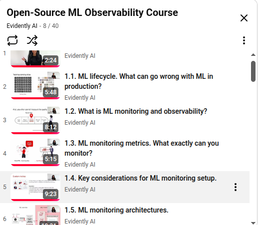

# Evidently AI notes

Notes from the [Open-Source ML Observability Course](https://learn.evidentlyai.com/) by Evidently AI.



## Modules

1. [Introduction](modules/01-introduction/)
2. [ML monitoring metrics](modules/02-ml-monitoring-metrics/)
3. [ML monitoring for unstructured data](modules/03-unstructured-data-monitoring/)
4. [Designing effective ML monitoring](modules/04-designing-ml-monitoring/)
5. [ML pipelines validation and testing](modules/05-pipeline-validation-testing/)
6. [Deploying an ML monitoring dashboard](modules/06-monitoring-dashboard/)

## Setup

Uses [uv](https://docs.astral.sh/uv/).

```bash
uv sync
uv run python -m ipykernel install --user --name evidently-ai-notes
```

Then pick the `evidently-ai-notes` kernel in Jupyter / VS Code, or select `.venv` as the interpreter.

## Links

- Course: https://learn.evidentlyai.com/
- Videos: https://www.youtube.com/playlist?list=PL9omX6impEuOpTezeRF-M04BW3VfnPBRF
- Evidently: https://github.com/evidentlyai/evidently

Course material and slides are by Evidently AI.
