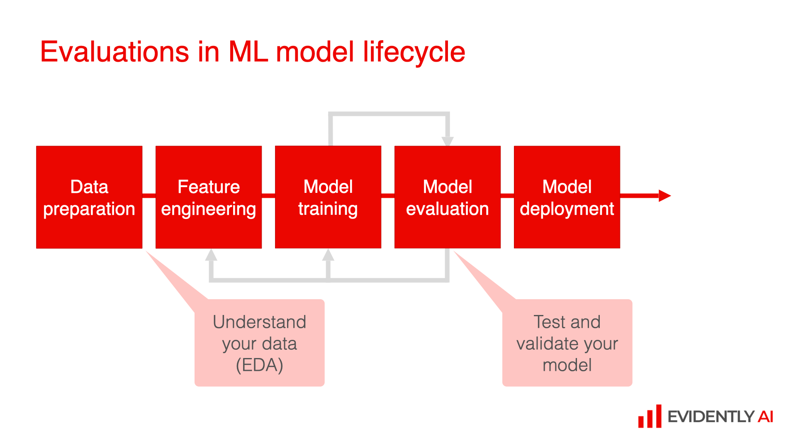
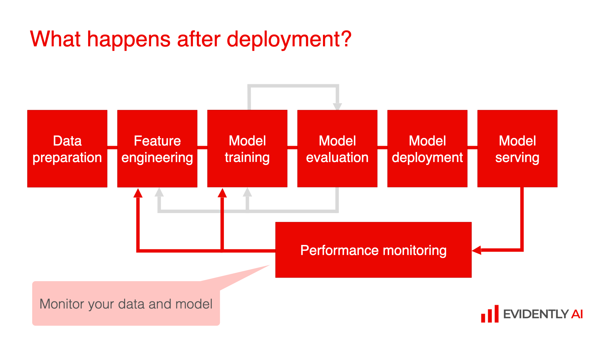
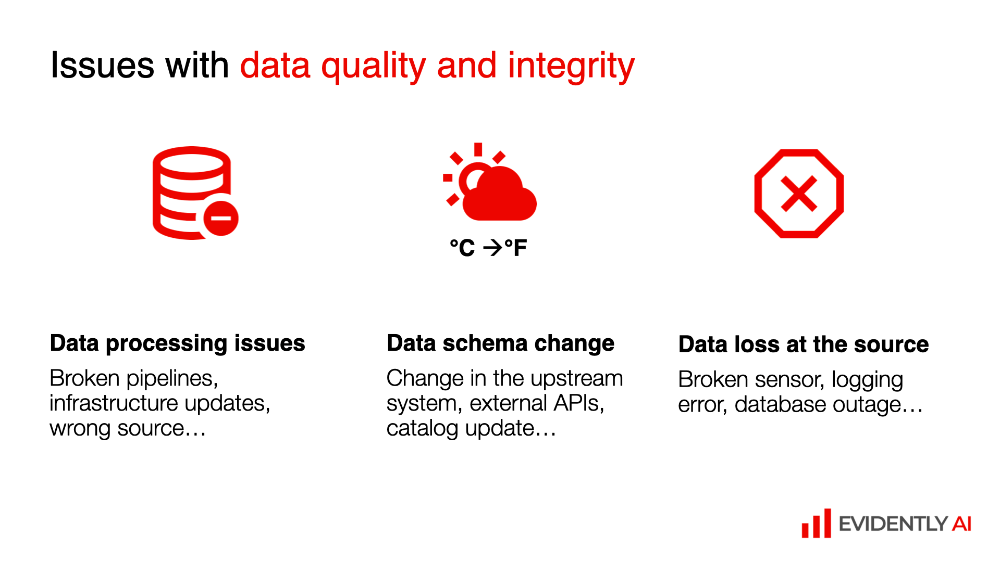
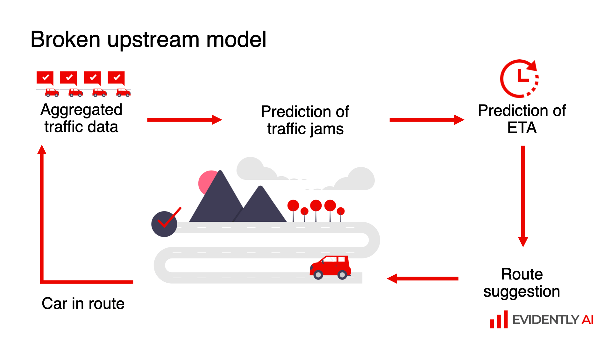
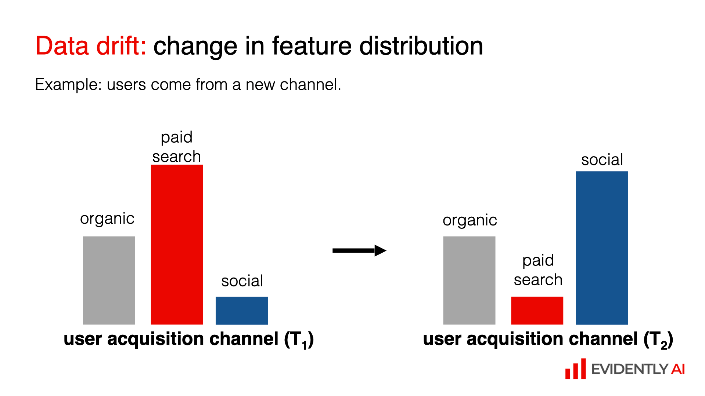
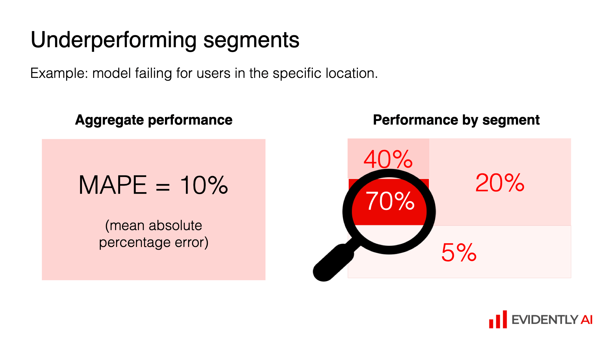

# 1.1 ML lifecycle. What can go wrong with ML in production?

## Lifecycle

Data preparation → feature engineering → training → evaluation → deployment.

Each stage has its own checks: EDA during data prep, cross-validation and holdout tests during experiments. After deployment, monitoring takes over, since every bad prediction now has a real cost.

## What can go wrong

**Training-serving skew** – production data differs from training data.

**Data quality issues** – the most common cause. Broken pipelines, upstream schema changes, data loss from sensors, logging bugs or outages.

**Broken upstream model** – models are often chained, so a bad output from one breaks the next.

**Concept drift** – the relationship between inputs and target changes. Can be gradual or sudden (e.g. COVID).

**Data drift** – the input distribution changes. E.g. a new acquisition channel brings users who behave differently.

**Underperforming segments** – fine on average, bad on a specific group.

**Adversarial adaptation** – someone actively trying to game the model.

## Data drift vs concept drift

- Data drift: X changes. Can be detected without labels.
- Concept drift: X → y changes. Usually needs labels to see.
