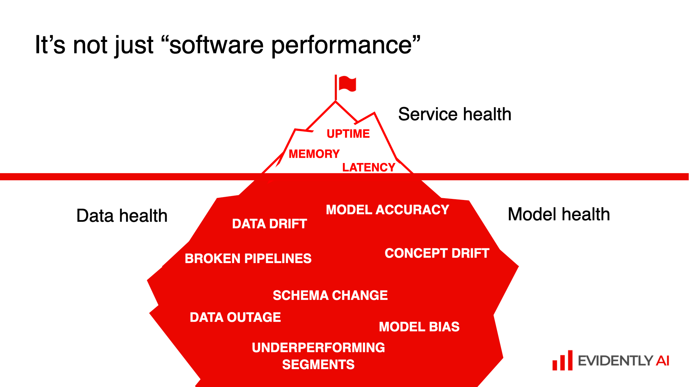
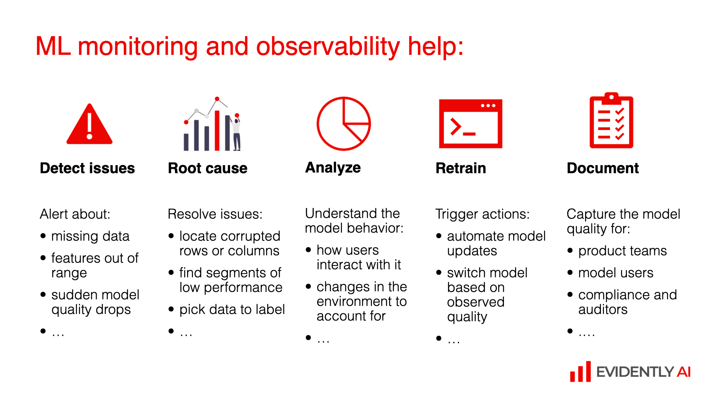
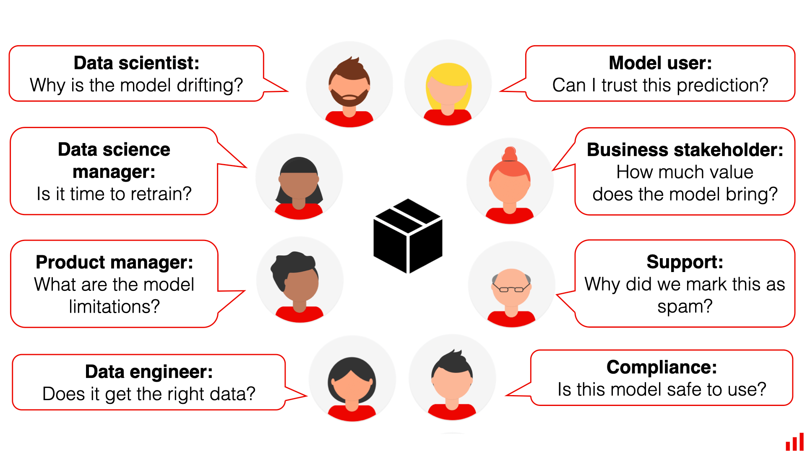

# 1.2 What is ML monitoring and observability?

## Monitoring

Tracking model performance in production to catch and fix issues early.

Used for:
- models in production
- shadow deployments (predictions made but not used)
- A/B tests

## Why it's harder than software monitoring

- On top of service health (uptime, latency, memory) you also need to watch **data health** and **model health**.
- Choosing metrics is case-specific. 99% accuracy means little on an imbalanced problem like fraud.
- Ground truth often arrives late, so you rely on proxies like data quality and drift.

## Monitoring vs observability

Monitoring: fixed set of metrics, tells you *what* happened, reactive.

Observability: visibility into the whole system, helps find *why*, proactive.

Monitoring is a subset of observability.

## What it's used for

- detecting issues (missing data, out-of-range values, drift, quality drops)
- root cause analysis
- understanding model behaviour
- triggering actions (fallback, switch model, retrain)
- reporting to stakeholders

## Who uses it

Data scientists (performance, drift), DS managers (when to retrain), PMs (model limits), data engineers (data quality), plus business, support and compliance.

