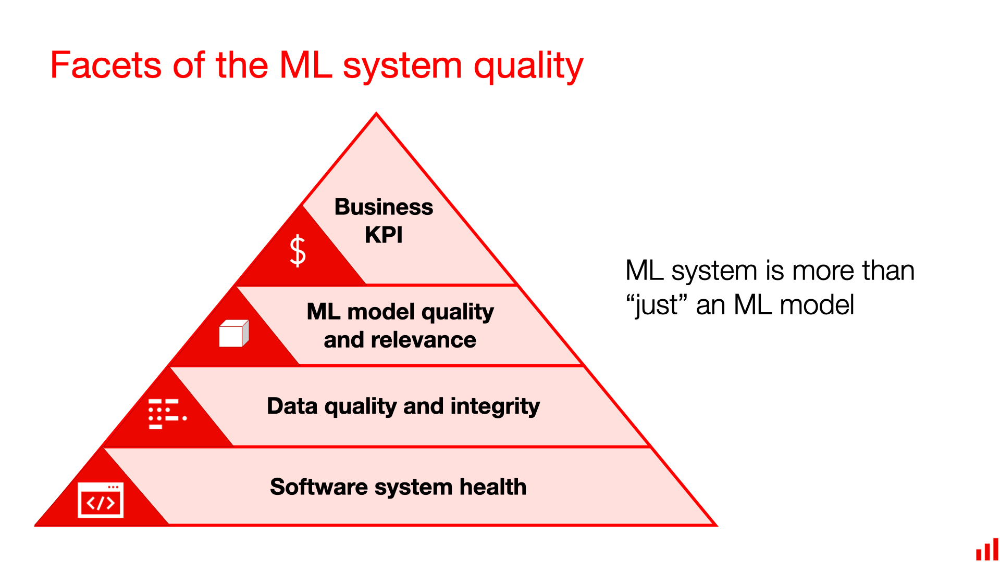

# 1.3 ML monitoring metrics. What exactly can you monitor?

An ML system is more than the model. Metrics fall into four groups:

**Software system health** – latency, error rate, memory, disk. Existing service monitoring can be reused.

**Data quality and integrity** – missing values, type mismatches, range violations. Most model issues start here.

**Model quality and relevance**
- classification: precision, recall
- regression: MAE, RMSE
- ranking: top-k accuracy
- fairness: predictive parity, equalized odds
- no labels yet: prediction drift, input drift, share of new categories

**Business KPIs** – clicks, purchases, approval rates, savings. Usually defined with the product/business team.

More on data and model metrics in Module 2.
