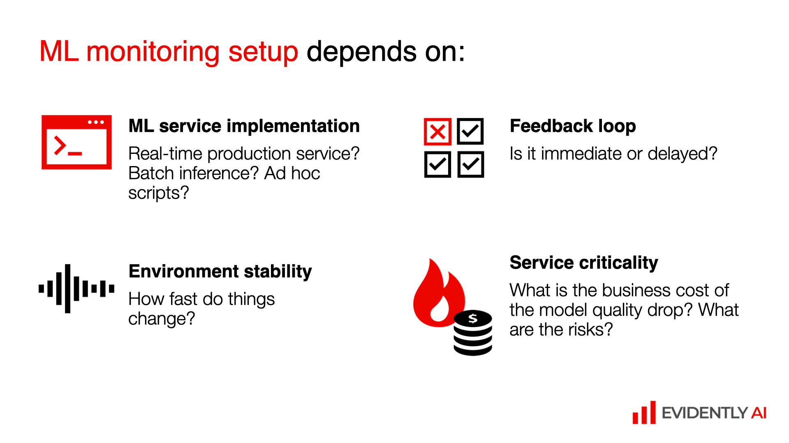
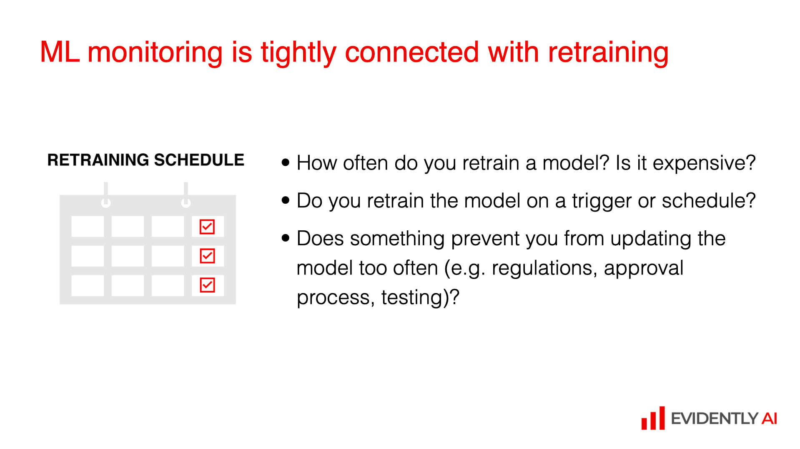

# 1.4 Key considerations for ML monitoring setup

## Match the setup to the use case

- How the model runs: real-time service, batch job, or ad hoc script
- How quickly labels come back, and how stable the environment is
- How critical the model is – higher cost of errors justifies more monitoring

## Retraining cadence

- How often and how costly retraining is
- Scheduled (e.g. weekly) or triggered by monitoring
- What blocks frequent updates: approvals, regulation, manual testing

## Reference dataset

A sample of "expected" data that new batches are compared against. Used to generate data quality checks and as a baseline for drift.

Can be fixed, a moving window, or several windows. You can use different references for different checks. Picking it carefully matters as much as picking metrics.

## Custom metrics

Standard metrics are a starting point. Often you also need:
- use-case metrics (e.g. lift@10% for churn)
- heuristics when there are no labels (e.g. share of predictions above a threshold)
- business metrics (e.g. estimated savings)
- custom drift methods

More in Module 4.
