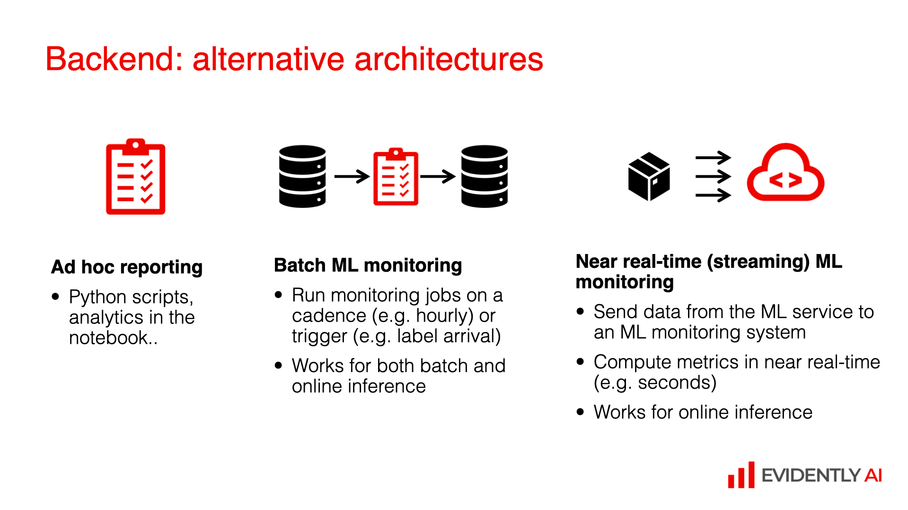
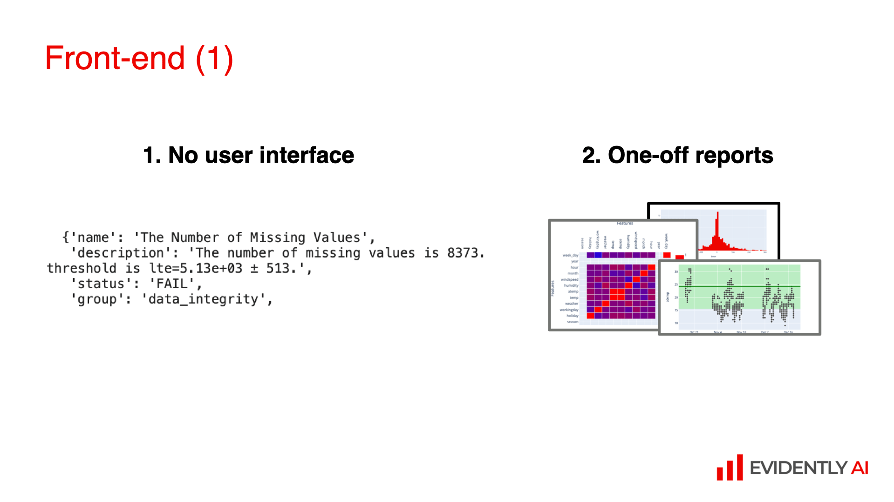
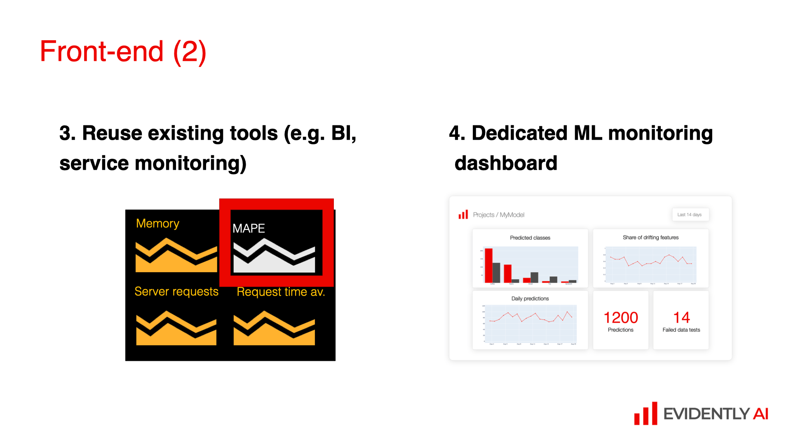

# 1.5 ML monitoring architectures

## Backend

**Ad hoc** – scripts or notebooks run when needed. Good first step.

**Batch** – a scheduled job (or one triggered by new labels) computes metrics and stores them. Works for both batch and online models.

**Near real-time** – the service sends data straight to a monitoring system that computes metrics on the fly. For online models that need fast feedback.

## Frontend

- **No UI** – log metrics to a database, add alerts.
- **One-off reports** – notebooks, HTML reports, BI one-offs.
- **Existing BI / monitoring tools** – connect them to the metrics database.
- **Dedicated ML monitoring** – one place for all models and datasets.

## Choosing

Depends on existing tools, number of models and team capacity. Start simple and add more later.

Code examples in Modules 5 and 6.
