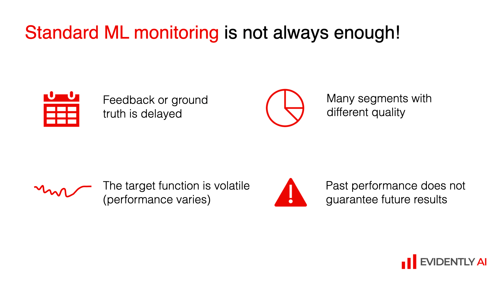
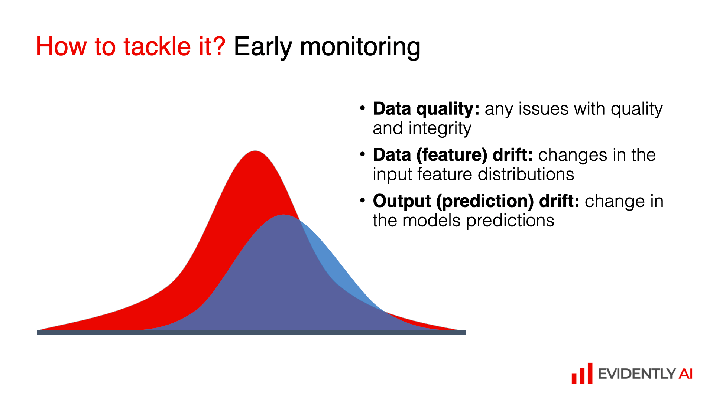

# 2.1 How to evaluate ML model quality

## Standard monitoring

Usually starts with:
- **Model quality / error metrics** – precision, recall, log-loss for classification; MAE for regression.
- **Business metrics** – purchases, clicks, views.

## Why it's not always enough

- Ground truth is delayed, so quality metrics can't be calculated yet.
- Past performance doesn't guarantee future results, especially in an unstable environment.
- Segments can perform very differently, and aggregate metrics hide that. Track them per segment.
- A volatile target makes metrics jumpy, so it's hard to tell a local dip from a real problem.

## Early monitoring

Use metrics based on data that is always available – model inputs and outputs:
- **Data quality** – integrity issues in inputs
- **Data drift** – changes in feature distributions
- **Output drift** – changes in predictions

These work as early warnings before labels arrive.

