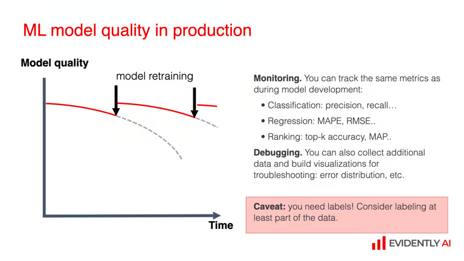

# 2.2 ML model quality metrics

Quality degrades over time. Labels are needed to compute any of these, so label at least part of the data if possible.

## Classification

- **Accuracy** – share of correct predictions. Misleading on imbalanced data.
- **Precision** – how many predicted positives are correct.
- **Recall** – how many actual positives were found.
- **F1** – harmonic mean of precision and recall.
- **ROC AUC** – how well probabilities rank positives above negatives.
- **Log loss** – how close predicted probabilities are to the truth.

Useful views: confusion matrix, precision-recall table by threshold, class separation, errors vs feature values.

## Regression

- **ME** – mean error. Positive and negative errors cancel out, but shows bias.
- **MAE** – mean absolute error.
- **RMSE** – penalizes large errors more.
- **MAPE** – error in %, good when target values differ in scale.
- **SMAPE** – symmetric MAPE, penalizes over- and underestimation differently.

Useful views: predicted vs actual, error over time, over- vs underestimation, extreme errors vs feature values.

## Ranking

Used for search and recommendations. What matters is the order of items, not the score itself. A model can produce perfectly calibrated scores and still put the wrong items on top.

### Data shape

One row per (user, item) pair the model scored:

| user_id | item_id | prediction | target |
|---------|---------|------------|--------|
| 1 | 42 | 0.91 | 1 |
| 1 | 17 | 0.85 | 0 |
| 1 | 8  | 0.60 | 1 |

- `prediction` – score or rank from the model
- `target` – relevance. Binary (clicked / not) or graded (rating 1–5).

Metrics are computed per user (or per query) for the top **k** items, then averaged. `k` should match what users actually see – if the UI shows 5 items, k=5.

### Relevance metrics

- **Precision@k** – share of top-k items that are relevant. "How much of what we showed was good?"
- **Recall@k** – share of all relevant items that made it into top k. "How much of the good stuff did we show?"
- **HitRate@k** – share of users with at least one relevant item in top k. Simple and easy to explain.
- **MRR** (mean reciprocal rank) – 1 / position of the first relevant item, averaged. Good when users only need one good result (search).
- **MAP@k** (mean average precision) – averages precision at each position where a relevant item appears. Rewards putting relevant items high.
- **Cumulative gain (CG)** – sum of relevance in top k. Ignores position.
- **DCG@k** – like CG but each item's relevance is divided by log2(position + 1), so relevant items lower down count less.
- **NDCG@k** – DCG divided by the best possible DCG for that user. Goes from 0 to 1, comparable across users and list lengths. Works with graded relevance.
- **Lift@k** – how much better than random ranking.

### Beyond accuracy

A recommender can score well on relevance and still be bad – e.g. showing everyone the same popular items. These metrics catch that and don't need labels:

- **Diversity** – how different the items in one list are from each other (needs item features).
- **Novelty** – how unpopular / less known the recommended items are.
- **Serendipity** – relevant *and* unexpected for this user.
- **Personalization** – how different lists are between users. Low = everyone gets the same thing.
- **Coverage** – share of the catalog that ever gets recommended.
- **Popularity bias** – whether the model over-recommends already popular items.

### What to watch in production

- **Feedback is implicit and delayed.** Clicks/purchases come later and are noisy. A non-click doesn't always mean "not relevant" – the user may not have seen it.
- **Position bias.** Items at the top get more clicks just because they're at the top. Logged data favours the current model's ranking.
- **Feedback loops.** The model learns from what it showed, so it keeps showing similar things. Watch personalization, coverage and popularity bias over time.
- **Users with no feedback.** Decide whether to include them (pulls metrics down) or exclude them.
- **Cold start.** New users and new items have little data – track them as a separate segment.
- **Business metrics.** CTR, conversion, revenue per session, time spent – the final check that ranking improvements matter.

## In production

- Avoid metrics that don't fit a live model. ROC AUC covers all thresholds, but production uses one.
- Add a proxy business metric, e.g. estimated loss from known error costs. From business ingisht we know what we want underprediction or overprediction if we had to choose one.
- Pick an aggregation window: hourly, daily, sliding 7 days.
- Track quality per segment (location, device, plan).

## Code

[notebooks/2.2-ml-model-quality.ipynb](notebooks/2.2-ml-model-quality.ipynb) – classification, regression and ranking reports with Evidently 0.7.

Exercises: [notebooks/2.2-exercises.ipynb](notebooks/2.2-exercises.ipynb)
